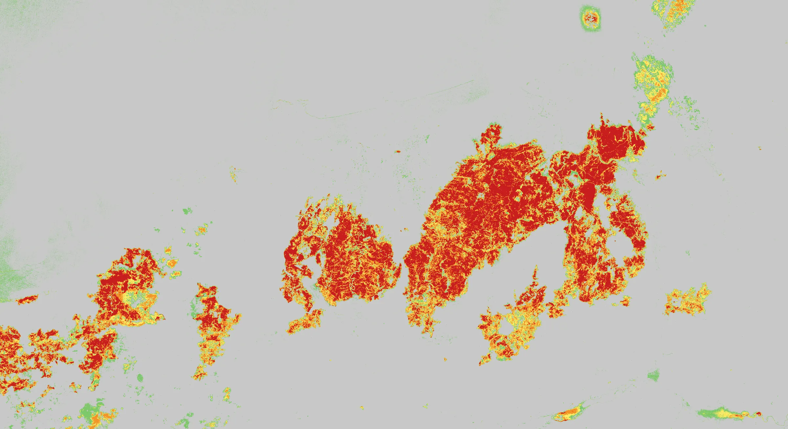

# Jijel Wildfires, August 2026

An independent geospatial reconstruction of the August 2026 wildfires in Jijel, Algeria. The analysis uses Python to combine satellite detections, burn-scar mapping, weather data, and public records. An Arabic Next.js application lets readers explore the evidence through an interactive map, a chronology, and a full report.

The study follows the fires from 22–29 August across Jijel Province and a 10 km buffer to examine where fire first appeared, how it spread, and which starts were likely independent.

[Live site](https://jijel-fires.vercel.app/) · [Interactive map](https://jijel-fires.vercel.app/map) · [Full report](https://jijel-fires.vercel.app/report) · [Data explorer](https://jijel-fires.vercel.app/data)



*Burn severity estimated from the change in Sentinel-2 reflectance between 18 and 28 August 2026.*

## Investigation at a glance

| Published dataset | What it measures |
| --- | --- |
| [9,100 thermal detections](public/generated/data/hotspots_wildfire_only.csv) | Satellite observations retained after removing a persistent industrial heat source. |
| [4,451 grid cells](public/generated/data/grid_first_detection.csv) | 375 m cells, each represented by its earliest observed detection. |
| [12 candidate origins](public/generated/data/independent_origins.csv) | Potential independent starts identified by the reachability analysis, including six in Jijel. |
| [17 burn scars](public/generated/data/burn_patches.csv) | Connected burn patches of at least 100 hectares derived from Sentinel-2 imagery. |

Sentinel-2 shows separate burn scars at Chekfa and Texenna, with intact vegetation between them. Fifteen-minute Meteosat observations narrow the window for detectable fire at Texenna, where polar-orbiting passes left a long gap. The report finds strong evidence for multiple independent starts and assigns moderate confidence to a human cause in the broad sense. Establishing the exact ignition point, cause, or intent requires field evidence. [Read the chronology](https://jijel-fires.vercel.app/chronology) · [Read the investigation](https://jijel-fires.vercel.app/investigation)

## Data collection

| Input | How it was gathered and used |
| --- | --- |
| NASA FIRMS active-fire detections | Downloaded seven-day near-real-time CSV snapshots for 375 m VIIRS on Suomi-NPP, NOAA-20, and NOAA-21, and 1 km MODIS Collection 6.1. These provided detection coordinates, acquisition times, confidence, and fire radiative power (FRP). [FIRMS downloads](https://firms.modaps.eosdis.nasa.gov/active_fire/) |
| Sentinel-2 MSI Level-2A imagery | Selected 18, 26, and 28 August scenes through the Element 84 Earth Search STAC catalog. The 18 and 28 August scenes supplied the before-and-after reflectance bands for mapping burn severity. [Earth Search catalog](https://earth-search.aws.element84.com/v1) |
| Meteosat-10 MSG/SEVIRI | Retrieved EUMETSAT LSA SAF FRP-PIXEL detection lists and quality grids in HDF5 at 15-minute intervals. The quality grids helped distinguish a clear view from an obscured observation. [LSA SAF product documentation](https://lsa-saf.eumetsat.int/data/map-service/) |
| Weather and terrain | Retrieved METAR observations for five Algerian stations from the Iowa Environmental Mesonet, hourly modeled weather from Open-Meteo, and 30 m Copernicus DEM tiles for elevation, slope, and aspect. The national comparison uses archived ERA5 weather fields via Open-Meteo. [METAR archive](https://mesonet.agron.iastate.edu/request/download.phtml) · [Open-Meteo](https://open-meteo.com/) · [Copernicus DEM](https://registry.opendata.aws/copernicus-dem/) |
| Geographic and documentary context | Queried OpenStreetMap through Overpass and Nominatim for boundaries, roads, infrastructure, and place names. Cross-checked official statements and press coverage for dates and locations, and logged inaccessible sources and records concerning other events. [OpenStreetMap](https://www.openstreetmap.org/copyright) · [Source register](public/generated/documentation/sources.md) |

The [full source register](public/generated/documentation/sources.md) records product IDs, date ranges, scene identifiers, citations, and access limitations. The FIRMS download links point to rolling feeds. The checked-in processed tables preserve the project's analysis snapshot.

## From observations to the report

1. **Normalize and clean the detections.** Clip the FIRMS records to the study area, retain UTC and Algeria local time (UTC+1), and mask 77 detections associated with persistent industrial heat at Bellara. Keep the earliest observation in each equal-area 375 m cell so repeated overpasses do not inflate the spatial analysis.
2. **Test whether fire could have spread from a previously observed location.** Compare space-time single-linkage clustering across 24 threshold combinations and use spatial DBSCAN as a comparison. The reachability screen flags cells at least 5 km from the nearest earlier detection and with a gap of at least 4 km along the tested spread path. Group the flagged cells and the earliest overpass detections to obtain the candidate origins.
3. **Map burn scars independently.** Calculate the Normalized Burn Ratio from Sentinel-2 bands B8A and B12 using `NBR = (B8A - B12) / (B8A + B12)`. Subtract post-fire NBR from pre-fire NBR to obtain dNBR. Apply a dNBR threshold of 0.27 for connected-component analysis and retain patches of at least 100 hectares.
4. **Refine timing with geostationary data.** For each candidate, compare the last clear scan without a detectable fire with the first positive detection. The published timing table narrows the window to roughly 15 minutes for six candidates. Cloud cover, pixel size, and detection sensitivity still limit what these windows resolve. [Ignition-window data](public/generated/data/msg-ignition-windows.json)
5. **Test competing explanations.** Compare spread with weather and terrain, test proximity to infrastructure against random reference points, and use a wider northern Algeria baseline to put the event in context. The report uses Bayesian-weighted Analysis of Competing Hypotheses (ACH) and sensitivity tests to show how the ranking changes when evidence weights change.
6. **Audit and document the findings.** Verify candidate coordinates and timestamps against the source records and cross-check geodesic distances with a separate Haversine calculation. The report includes confidence levels, counterevidence, data gaps, and the tests' ability to detect the patterns under study. [Methodology](https://jijel-fires.vercel.app/methodology) · [Report source](content/report_ar.md)

## Application architecture

| Area | Implementation |
| --- | --- |
| Scientific processing | Python scripts in the separate investigation workspace, with pyproj for geodesic calculations and Matplotlib for figures. |
| Site and UI | Next.js 16 App Router, React 19, TypeScript, Tailwind CSS 4, and shadcn/ui on Radix. Narrative pages are statically rendered. Client components handle interaction, with Motion for transitions and support for reduced-motion preferences. |
| Geospatial visualization | MapLibre GL JS renders local GeoJSON layers and a georeferenced burn-severity raster. Date and layer controls filter observations. Burn patches appear as centroids, and a static Sentinel-2 image provides a fallback when the interactive map cannot load. [Map component](components/fire-map.tsx) · [Map assets](public/maplibre/) |
| Charts and data | Recharts powers interactive charts, and SVG renders the thermal timeline. The data explorer reads checked-in CSV and JSON and exposes filterable tables and individual downloads. [Data route](app/data/page.tsx) · [Processed data ZIP](public/generated/downloads/jijel-fire-processed-data.zip) |
| Report publishing | One Arabic Markdown source powers the chapter-linked web report and the A4 print route. React Markdown, remark-gfm, and rehype-slug render tables and heading anchors. Print CSS formats the document for the browser's Save as PDF action. The interface uses RTL layout with LTR treatment for coordinates, identifiers, and scientific notation. [Report renderer](components/report-markdown.tsx) · [Print route](app/report/print/page.tsx) |

The repository contains the web application in [`app/`](app/), presentation components in [`components/`](components/), data and document readers in [`lib/`](lib/), and publishing and verification utilities in [`scripts/`](scripts/). The versioned release inputs live in [`public/generated/`](public/generated/) and [`public/maplibre/`](public/maplibre/).

## Run locally

Use Node.js 22 and npm. A fresh clone runs from the checked-in release inputs.

```bash
git clone https://github.com/raedinkhaled/algeria-fires.git
cd algeria-fires
npm ci
npm run dev
```

Open [localhost:3000](http://localhost:3000).

```bash
npm run lint
npm run test
npm run build
npm run typecheck
npm start
```

`npm run test` checks release files, route coverage in the sitemap, and metadata. The production prebuild copies the MapLibre worker from the installed package, checks the four reference dataset counts, and verifies file sizes and SHA-256 hashes for listed figures and downloads. The production build uses Webpack. The build fetches the IBM Plex fonts through `next/font`.

For Vercel, set `NEXT_PUBLIC_SITE_URL` to the production origin so the site's metadata, sitemap, and robots file use the public URL.

### Regenerate the data snapshot

`npm run data:build` is the maintainer workflow. It requires the separate local `Fires/` workspace, its raw inputs, a Python environment, and the `zip` command. The workflow exports processed tables and map assets, converts 22 figures to WebP with Sharp, and packages the downloadable data with a hash manifest. [Publishing scripts](scripts/)

## Data attribution

See the [source register](public/generated/documentation/sources.md) for dataset provenance and citations. OpenStreetMap data © [OpenStreetMap contributors](https://www.openstreetmap.org/copyright), under the ODbL. Third-party datasets are subject to their providers' terms.
